<!-- HEADER -->

  

<!-- ABOUT ME -->
<h2 align="center">💫 About Me</h2>

  Nothing special, just exploring and building things with code.

<!-- TECH STACK -->
<h2 align="center">💻 Tech Stack</h2>

  
  
  
  
  
  
  
  
  
  
  
  
  
  
  
  
  

<!-- RANDOM DEV QUOTE -->
<h2 align="center">✍️ Random Dev Quote</h2>

  

<!-- PROFILE VISITORS -->
<h2 align="center">👀 Profile Visitors</h2>

  

<!-- PACMAN CONTRIBUTION GRAPH -->
<h2 align="center">👾 Contribution Arcade</h2>

<picture>
  <source media="(prefers-color-scheme: dark)" srcset="https://raw.githubusercontent.com/j1rooo/j1rooo/pacman-output/pacman-contribution-graph-dark.svg?game=pacman">
  <source media="(prefers-color-scheme: light)" srcset="https://raw.githubusercontent.com/j1rooo/j1rooo/pacman-output/pacman-contribution-graph.svg?game=pacman">
  
</picture>

<!-- FOOTER -->

  

